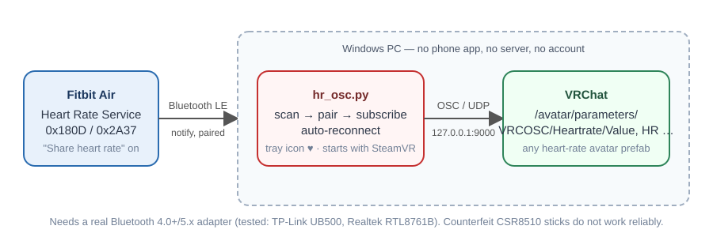
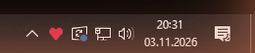
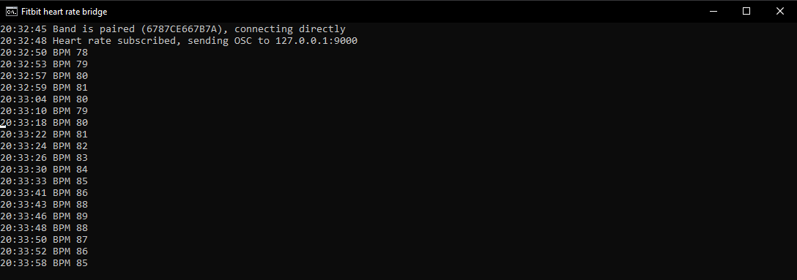

# Fitbit Air → VRChat heart rate over OSC

Show your live heart rate on your VRChat avatar **without a phone app, without HypeRate/Pulsoid and without any
account**. A small Python program on your Windows PC reads the heart rate straight from the Fitbit Air over
Bluetooth LE and sends it to VRChat via OSC. It runs as a tray icon and can start automatically with SteamVR.



*Deutsch: Anleitung weiter unten → [Deutsche Kurzanleitung](#deutsche-kurzanleitung).*

## What you need

| | |
|---|---|
| **Band** | Fitbit Air (Google). Other bands that expose the standard Bluetooth *Heart Rate Service* (0x180D) should work too, but only the Fitbit Air was tested. |
| **PC** | Windows 10/11, Python 3.11 or newer from [python.org](https://www.python.org/downloads/) (tick *Add python to PATH*). |
| **Bluetooth** | A real Bluetooth LE adapter. Tested and recommended: **TP-Link UB500** (Realtek RTL8761B, ~10 €). Cheap no-name sticks that identify as *CSR8510 A10* are counterfeits: they go deaf after ~15 s of scanning, cannot scan while paired and drop the connection. They do not work reliably. |
| **VRChat** | OSC enabled (Action menu → Options → OSC → Enabled) and an avatar with a heart-rate prefab, see [Avatar parameters](#avatar-parameters). |

## Install

1. Download this repository (green **Code** button → *Download ZIP*) and unpack it, e.g. to `C:\Tools\fitbit-osc`.
2. Double-click **`install.bat`**. It creates a private Python environment and installs the dependencies (bleak, WinRT, pystray, pyopenvr). Takes about a minute.
3. On the phone, once: **Google Health → Fitbit Air → Share heart rate → on**, and **Always visible → on**.
   This is a setting stored in the band itself; afterwards the phone is not involved anymore.
   Close the HypeRate app if you had it, the band shares with one device at a time.
4. If you use **VRCOSC** with its HypeRate or Pulsoid module: disable that module, otherwise two programs
   write the same parameters.

## Run

| | |
|---|---|
| **`start-tray.bat`** | Runs invisibly with a heart icon in the system tray. Grey = no band, red = heart rate flowing. Hover for the current BPM, right-click for *Open log* / *Quit*. |
| **`start.bat`** | Same, but in a console window so you can watch what happens. Add options after the name, e.g. `start.bat --chatbox`. |



What happens on the first run: the band is found within a few seconds, Windows pairs with it (the bridge
accepts the pairing request itself), the heart rate is subscribed and the first value reaches VRChat about
five seconds after the band was seen.



If the band disconnects, the bridge reconnects on its own. If the paired band stays unreachable twice in a
row, it removes the pairing and searches again, because the band changes its Bluetooth address from time to
time.

### Options

```
--chatbox        also show "♥ 72 BPM" in the VRChat chatbox every 3 s
--min 40 --max 200   range used for HRPercent / Normalised (default 0–255)
--ip / --port    OSC target, default 127.0.0.1:9000 (VRChat)
--name fitbit    prefer devices whose name contains this; any 0x180D device is accepted
--demo           no band: send synthetic values, handy for testing the avatar
--tray           tray icon instead of console, log goes to fitbit-osc.log
--follow-steamvr exit ~20 s after SteamVR closes (used by the SteamVR autostart)
```

## Start automatically with SteamVR

```
.venv\Scripts\python.exe register_steamvr.py
```

This registers the bridge as a SteamVR overlay application with autostart, the same mechanism VRCOSC and
other VR tools use. From then on SteamVR launches it (tray mode) and it quits itself shortly after SteamVR
closes. You can toggle it in SteamVR under *Settings → Startup/Shutdown → Choose startup overlay apps*.
Undo with `register_steamvr.py --remove`. If you move the folder, run the script again.

## Avatar parameters

The bridge sends several parameter families at once so most heart-rate prefabs work out of the box.
All addresses are `/avatar/parameters/<name>`.

| Name | Type | Value | Used by |
|---|---|---|---|
| `VRCOSC/Heartrate/Value` | int | BPM (0–255) | VRCOSC heart-rate prefab |
| `VRCOSC/Heartrate/Normalised` | float | 0…1 | VRCOSC |
| `VRCOSC/Heartrate/Units`, `Tens`, `Hundreds` | int | digits | VRCOSC |
| `VRCOSC/Heartrate/Enabled` | bool | band connected | VRCOSC |
| `HR` | int | BPM | HRtoVRChat_OSC style prefabs |
| `onesHR`, `tensHR`, `hundredsHR` | int | digits | HRtoVRChat_OSC |
| `HRPercent`, `FullHRPercent` | float | 0…1 / −1…1 | HRtoVRChat_OSC |
| `isHRConnected`, `isHRActive` | bool | status | HRtoVRChat_OSC |
| `isHRBeat`, `HeartBeatToggle` | bool | toggles with each heartbeat | HRtoVRChat_OSC |

If your prefab uses other names, edit `send_hr()` in `hr_osc.py`; it is a handful of lines.
Remember that many prefabs also have a menu toggle on the avatar that has to be switched on.

### No heart-rate prefab on your avatar yet?

The bridge works out of the box with the official **VRCOSC Heartrate prefab** (a number display with a
beating heart), made by VolcanicArts:

**[Download VRCOSC-Heartrate.unitypackage](https://vrcosc.com/assets/files/VRCOSC-Heartrate-44bc3d431ee04ea4fe13c84162417987.unitypackage)**
(from the [VRCOSC prefab downloads](https://vrcosc.com/docs/downloads#prefabs))

1. Install [VRCFury](https://vrcfury.com/download) in your avatar project (VRChat Creator Companion).
2. Install RED_SIM's free [Simple Counter Shader](https://www.patreon.com/posts/simple-counter-62864361), the prefab uses it for the digits.
3. Import the unitypackage, drag the `Heartrate` prefab onto your avatar (e.g. onto the chest bone) and upload.
4. In VRChat, switch the *Heartrate* toggle on in your avatar's expression menu.

The prefab only needs `VRCOSC/Heartrate/Value`, which the bridge sends. It is not included in this
repository because it is VolcanicArts' work; please get it from the link above.

## How it works

The connection sequence mirrors what the official HypeRate Android app does (scan for service 0x180D,
connect, enable notifications on characteristic 0x2A37), with three things the app gets wrong fixed:

- The heart-rate flags byte is evaluated correctly, so 16-bit values are read properly.
- The band is paired deliberately. Without pairing the Fitbit Air disconnects after 20–30 s.
  Android pairs implicitly on the first protected access, Windows only on request.
- Lost connections are re-established automatically.

Pairing is done through the Windows Bluetooth API only, with no second connection held by the script at the
same time; a parallel connection made pairing fail and left the band invisible.

## Troubleshooting

| Symptom | What to check |
|---|---|
| `No band seen` | Heart-rate sharing on? HypeRate app closed? Band awake and on the wrist? Adapter is a real Bluetooth LE adapter? |
| `Pairing status 19` | The band dropped the connection during pairing. The bridge retries; if it keeps failing, toggle *Share heart rate* off and on, the band then uses a fresh address. |
| Values arrive but the avatar shows nothing | OSC enabled in VRChat? Prefab menu toggle on? Parameter names match (see table)? |
| Connection drops every ~15 s | Almost always the Bluetooth adapter. Try a different USB port or an extension cable away from the PC case, or a better adapter. |
| Two bridges fight over the band | Only one instance runs at a time; a second start exits immediately. Check the SteamVR autostart isn't running next to a manual start. |

The log lives in `fitbit-osc.log` next to the script when running in tray mode.

## Deutsche Kurzanleitung

1. **Installieren:** Repository als ZIP laden, entpacken, `install.bat` doppelklicken (braucht Python 3.11+ von python.org).
2. **Band einmalig einrichten:** Am Handy in Google Health → Fitbit Air → *Herzfrequenz teilen* an, *Immer sichtbar* an. Danach läuft alles ohne Handy; HypeRate-App schließen oder löschen.
3. **Starten:** `start-tray.bat` (unsichtbar, Herz-Symbol im Tray: grau = kein Band, rot = Puls kommt) oder `start.bat` (mit Fenster). Rechtsklick auf das Symbol: *Open log* / *Quit*.
4. **Mit SteamVR starten:** `.venv\Scripts\python.exe register_steamvr.py`. Ab dann startet SteamVR die Brücke selbst und sie beendet sich nach SteamVR von selbst.
5. **VRChat:** OSC einschalten (Action-Menü → Options → OSC → Enabled), Avatar mit Puls-Prefab anziehen, dessen Menü-Schalter an. Hast du VRCOSC mit HypeRate-Modul: Modul abschalten.
   Noch kein Puls-Prefab? Das offizielle [VRCOSC-Heartrate-Prefab](https://vrcosc.com/assets/files/VRCOSC-Heartrate-44bc3d431ee04ea4fe13c84162417987.unitypackage) passt direkt (braucht VRCFury und RED_SIMs Counter Shader, siehe oben).
6. **Bluetooth-Stick:** Ein echter Bluetooth-LE-Stick ist Pflicht, getestet mit TP-Link UB500. Billige „5.0“-Sticks, die sich als CSR8510 melden, sind Nachbauten und funktionieren nicht zuverlässig.

## License

MIT, see [LICENSE](LICENSE).
